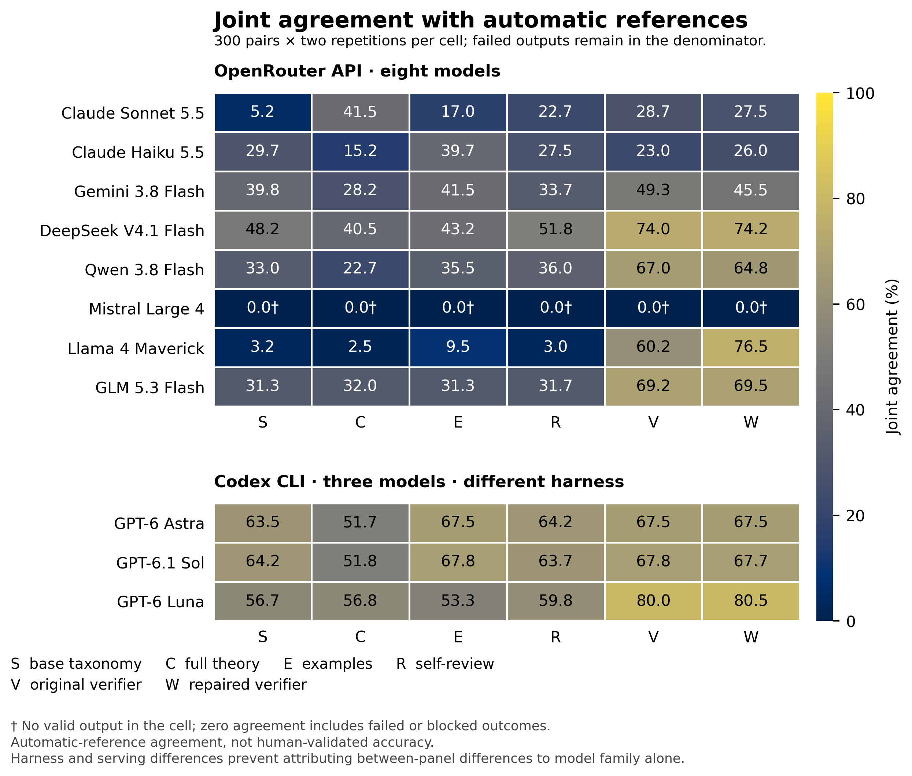
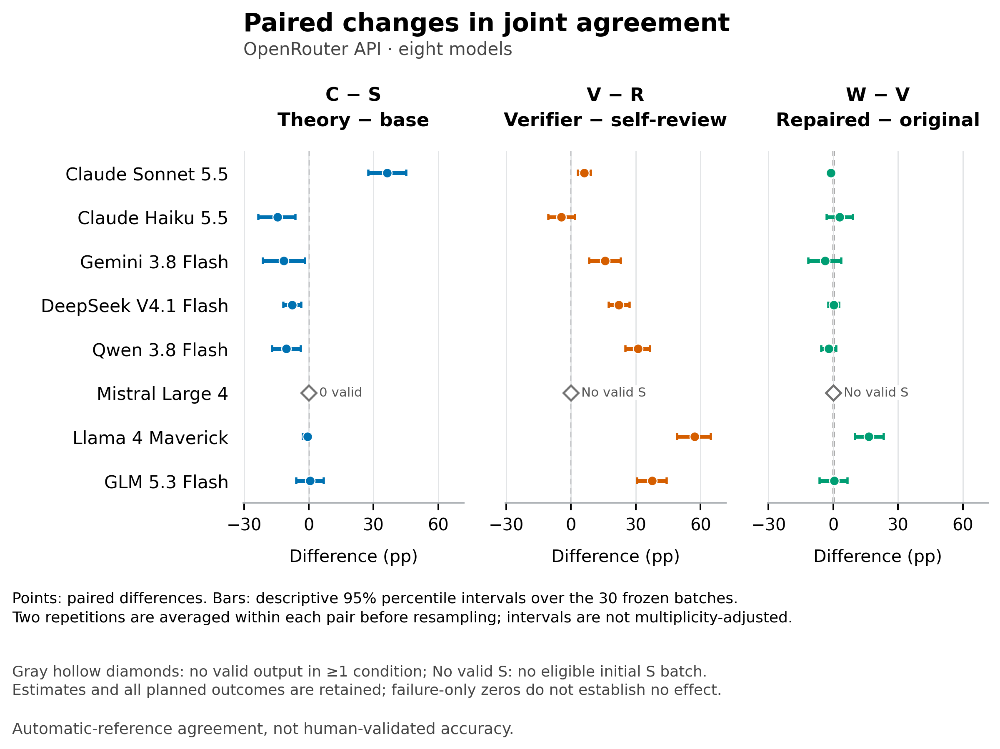
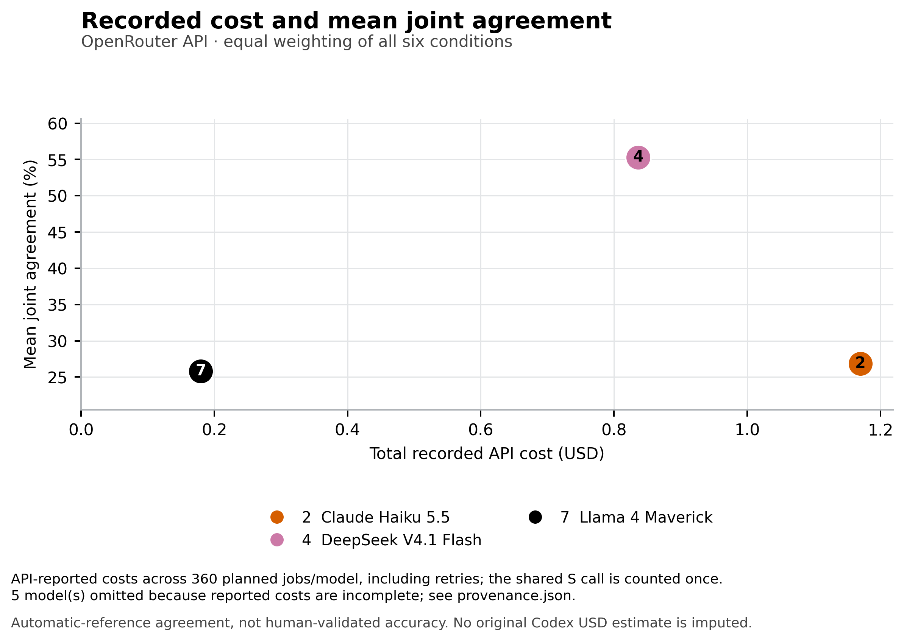

# Greek Rhyme Eval

Code and public numerical replay for a Greek rhyme study comparing compact instructions, theoretical context, examples, self-revision and phonological feedback.

**The scores measure agreement with automatic reference labels, not human-validated linguistic accuracy.** The main evaluation covers the same 300 Greek verse pairs across 11 requested models in two separately frozen waves: three Codex models and eight direct-API models, with six conditions and two repetitions in each wave. The additional 40 historical pairs belong only to the original Codex wave.

See the [eight-model extension methods and results](docs/EXTENSION_2026-10-10.md) and [extension figures](#extension-figures) for the added wave and comparisons. The extension was designed and frozen after the original results existed.

## Original Codex-wave results

Joint agreement requires both the stress class and the complete unordered feature set to match. Percentages below use all 600 predictions per model/condition.

| Condition | Astra | Sol | Luna |
|---|---:|---:|---:|
| S · compact taxonomy | 63.50 | 64.17 | 56.67 |
| C · S + recovered theory text | 51.67 | 51.83 | 56.83 |
| E · S + 15 examples | 67.50 | 67.83 | 53.33 |
| R · self-revision of S | 64.17 | 63.67 | 59.83 |
| V · original verifier feedback on S | 67.50 | 67.83 | 80.00 |
| W · repaired verifier feedback on S | 67.50 | 67.67 | 80.50 |


Requested aliases were `gpt-6-astra`, `gpt-6.1-sol` and `gpt-6-luna`, with high reasoning effort through Codex CLI. These are serving aliases; immutable backend weights were not independently attested. The recorded inference dates were 8–9 October 2026.

The full theory condition reduced Astra/Sol agreement, whereas verifier feedback improved Luna most. These observations do not establish that the theory is linguistically wrong or that feedback improves human-judged accuracy: the reference labels and verifier share lineage, and their feature conventions differ in known ways. See [design and interpretation](docs/DESIGN.md).


## Reproduce the public numbers

Python 3.11+ is required. Numerical replay uses NumPy 2.4.1; optional plots use Matplotlib 3.10.8. The original numerical environment was Python 3.11.9 on Windows. Public CI runs synthetic tests and numerical replay without model credentials.

```bash
python -m pip install -e .
python -B -m unittest discover -s tests -v
python -B tools/replay_results.py
```

The last command recomputes original-wave item metrics, averages repetitions, runs the fixed 10,000-resample bootstrap and compares **every released original-wave summary field exactly**. It writes a verification report and LaTeX table under `build/replay/`. For another run, choose a new output directory, e.g. `--output build/replay2`.

To render the aggregate figures as well:

```bash
python -m pip install -e ".[figures]"
python -B tools/replay_results.py --figures --output build/replay_with_figures
```

Public replay verifies arithmetic from the released records. It cannot independently reconstruct labels from the omitted model responses, attest the provider, or replay private event logs. The frozen full-evidence analysis remains in [`study_2026-10-08/analysis.py`](study_2026-10-08/analysis.py); the public adapter calls its original scoring/statistical functions without bypassing its private-evidence CLI or pretending those inputs are present.

## What is included

| Location | Contents |
|---|---|
| [`results/`](results/) | Original-wave records: 11,040 label-only predictions, 5,520 repeat-averaged item records, 680 baseline records, 1,104 aggregate job records and the complete original-wave numerical summary |
| [`results/extension_2026-10-10/`](results/extension_2026-10-10/) | Extension records: 28,800 label-only predictions, 14,400 repeat-averaged item records, 2,880 planned aggregate jobs, the complete extension summary and matched original-wave comparisons |
| [`study_2026-10-08/`](study_2026-10-08/) | Original runner, scorer, dataset/experiment preparation glue and verifier interface; portable theory-text extraction procedure |
| [`src/rhyme_bench/`](src/rhyme_bench/) | Earlier general evaluation library with explicit reference-status checks; separate from the completed study's scorer |
| [`tests/`](tests/) | Synthetic library, runner, scorer and public-adapter tests; no model calls |
| [`provenance/`](provenance/) | Historical hashes, pinned source identity, public sanitization record and release integrity manifest |
| [`docs/RECONSTRUCTION.md`](docs/RECONSTRUCTION.md) | Requirements and boundaries for separate private reconstruction or new inference |

The release excludes source poetry, the upstream unlicensed verifier/corpus, repaired derivative modules, the full theory text/PDF, raw study prompts/responses/events, account/session metadata and manuscript PDFs. The separate format/load diagnostic releases newly constructed artificial inputs and their exact request specification, without raw HTTP records. Source/author group names are replaced by opaque codes; grouping and seeded bootstrap order are preserved. See [data schema](docs/DATA.md) and [rights](RIGHTS.md).

## Attribution

This study builds on Stergios Chatzikyriakidis and Anastasia Natsina's [*LLMs Got Rhyme?* (2026)](https://aclanthology.org/2026.latechclfl-1.9/) and the [Greek_Rhyme repository](https://github.com/StergiosCha/Greek_Rhyme), pinned to `8ee1773d51133213a87b800ef049ad6e2800f7cd`. The C condition used the complete recovered text of Nina Topintzi, Konstantinos Avdelidis and Theodora Valkanou's [*Quantifying Greek Rhyme* (2019)](https://ntopintzi.wixsite.com/webpage/copy-of-research), pages 429–447.

This repository releases research code/results. It does not imply author approval of a manuscript, conference submission or acceptance. Original code licensing is scoped in [RIGHTS.md](RIGHTS.md); no rights to omitted third-party material are granted.

## Eight-model direct-API extension

The extension was designed and frozen after the original results existed. It adds eight model/provider configurations on the same main300 design: 28,800 prediction records, six conditions and two repetitions. [Methods, limitations and replay](docs/EXTENSION_2026-10-10.md) describe the direct-API versus Codex comparison. Run `python -B tools/replay_extension_results.py` to verify the added label-only numerical records; the original results and replay remain intact.

Use Python 3.11 for the complete public replay workflow. The extension adapter preserves its recorded Python 3.12 summation through module-local arithmetic bindings and passes exact checks on both tested runtimes; the unchanged original-wave CLI remains pinned to Python 3.11. Frozen results and source bytes remain unchanged.

A separate [post hoc synthetic format/load diagnostic](docs/EXTENSION_2026-10-10.md#separate-post-hoc-synthetic-formatload-diagnostic) reports 24 planned jobs on artificial sentences for Sonnet and Mistral. It assesses formatting and completion, adds no main-study scores, and uses a separate USD 3 ledger. Its exact artificial-input specification and sanitized descriptive outcomes are included; raw HTTP and account records are excluded.

[Post hoc repair localization](docs/EXTENSION_2026-10-10.md#post-hoc-repair-localization) partitions V/W changes across 50 IDs with changed structured `raw_feedback` and 250 with matching `raw_feedback`, for all eleven models. Aggregate counts and opaque memberships are included without raw feedback. Run `python -B scripts/replay_repair_localization.py --public-root .`; it changes no main results and does not identify a causal repair mechanism.

### Extension figures

These plots contain numeric results and model labels only. The original-wave figures above retain their original scope. [Figure hashes, source-summary hashes and missing-cost exclusions](assets/extension_2026-10-10/provenance.json) accompany the final plots.






